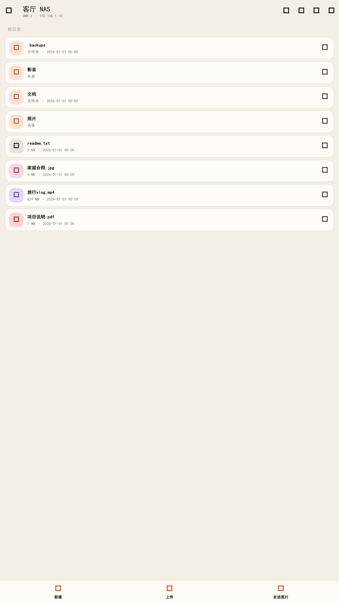
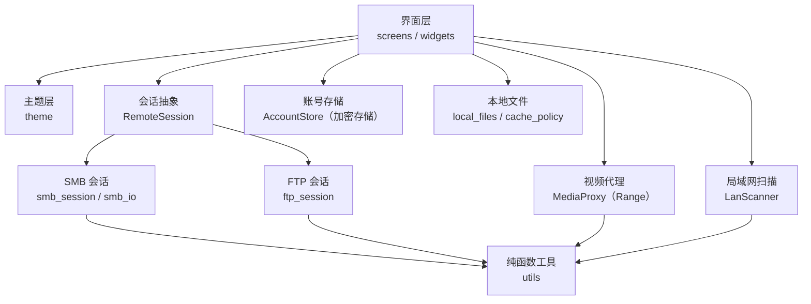

<p align="center">
  
</p>

<p align="center">
  
  
  
  
  
</p>

# nas_client

**把身边的网盘，轻轻装进口袋。**

nas_client 是一个开源的 Android 文件客户端，用来在同一个局域网里访问 **Samba / SMB** 和 **FTP** 服务器上的文件。手机连上 Wi-Fi 后，它可以自动发现设备、记住账号，然后像浏览本地文件夹一样查看、预览、上传和下载文件——不需要公网穿透，不需要账号注册，也不把数据交给任何第三方服务。

它是为「家里的 NAS、旧电脑上的共享文件夹、路由器挂着的硬盘」这类场景做的：设备都在同一个 Wi-Fi 下，数据留在自己家里。

> **名称说明**：仓库与 Dart 包名为 `nas_client`，应用在手机桌面上显示的名字是**近邻盘**——取意于局域网里近在咫尺的共享设备。Android 应用 ID 为 `com.nasclient.app`。当前版本 **1.1.0**（`pubspec.yaml` 中的 `1.1.0+2`）。

---

## 目录

- [功能一览](#功能一览)
- [界面与交互](#界面与交互)
- [快速开始](#快速开始)
- [使用指南](#使用指南)
- [协议支持矩阵](#协议支持矩阵)
- [架构与目录](#架构与目录)
- [实现细节](#实现细节)
- [数据与隐私](#数据与隐私)
- [构建与发布](#构建与发布)
- [测试](#测试)
- [局限与已知问题](#局限与已知问题)
- [路线图](#路线图)
- [常见问题](#常见问题)
- [贡献、安全与许可证](#贡献安全与许可证)
- [致谢](#致谢)

---

## 功能一览

| 类别 | 能力 |
| --- | --- |
| 发现设备 | 扫描当前 Wi-Fi 所在的私有 IPv4 `/24` 网段，探测 SMB（445 / 139）与 FTP（21 / 990）；读取 NetBIOS 计算机名与 FTP 欢迎语 |
| 连接 | 手动填写主机、端口、用户名、密码、域与别名；支持匿名 FTP；支持指定协议模式，也支持自动协商回退 |
| 账号 | 凭据存入系统加密存储；启动时自动重连当前网络里可达的、最近用过的服务器；可保存多台并随时切换 |
| 浏览 | 共享与目录列表、面包屑导航、排序、新建文件夹、重命名、删除、查看详情（大小 / 时间 / 路径） |
| 传输 | 从系统相册、相机或本地文件选择上传；下载到系统「下载」文件夹或自定义位置；上传与下载均有进度显示，可随时取消，取消后清理半成品文件 |
| 下载位置 | 三选一：系统下载文件夹（推荐，文件管理器可见）/ 应用私有目录 / 自定义文件夹；通过系统文件夹选择器一次授权，无需存储权限 |
| 预览 | 应用内查看图片与文本；视频通过本机回环代理边读边播，支持播放器跳转；播不了时可下载后用其他应用打开 |
| 本地文件 | 「下载」与「缓存」两个独立分区，可打开、重命名、移动、删除，支持一键清理缓存 |
| 外观 | 跟随系统 / 白天 / 夜间三种模式，选择持久化保存；统一的暖色系设计语言 |
| 其他 | 友好的错误信息、未捕获异常的兜底页面、离开播放页或应用进入后台时自动释放服务器连接 |

---

## 界面与交互

应用由四个主要页面组成：

1. **启动页** — 显示品牌图标，同时在后台整理本地缓存、读取已保存账号、探测可达性并尝试自动登录。
2. **首页（服务器）** — 列出扫描到的设备与已保存的账号，提供「搜索局域网设备」和「手动添加」两个入口，以及外观切换。
3. **文件浏览** — 远程目录的主界面，顶部是面包屑路径，底部提供新建、上传等操作；长按条目可打开、下载、重命名、删除或查看详情。
4. **预览 / 本地文件** — 图片与文本直接渲染，视频进入播放器；「本地文件」页用两个标签页分别管理「下载」和「缓存」。

### 界面预览

以下截图由合成数据渲染（示例地址、示例账号），不含任何真实设备、账号或文件信息。

<p align="center">
  
  
</p>

<p align="center">
  
</p>

图标是一间暖色的小屋：圆窗里有一颗心，屋顶的天线表示连接，左右两个小节点分别用绿色代表 Samba、蓝色代表 FTP。矢量源文件在 [`assets/brand/logo.svg`](assets/brand/logo.svg)，所有尺寸的位图由 [`tools/generate_branding.py`](tools/generate_branding.py) 生成。

---

## 快速开始

### 环境要求

| 项目 | 要求 |
| --- | --- |
| Flutter | stable 通道，`pubspec.yaml` 中 `environment.sdk: ^3.12.2` 或兼容的更新版本（开发时使用 3.47.x） |
| Dart | 随 Flutter SDK 提供 |
| Android SDK / NDK | 使用 Flutter 自带的 `flutter.compileSdkVersion` / `flutter.ndkVersion`，无需在工程里手改 |
| JDK | 17 及以上（Android Gradle 插件与 Kotlin 编译目标均为 17） |
| 设备 | 一台开启 USB 调试或无线调试的 Android 手机 |
| 网络 | 手机与 SMB / FTP 服务器处于同一局域网，服务器已开启对应服务 |

目前**只支持 Android**。Windows / macOS / Linux / iOS 均未提供工程配置；Windows 桌面目标还需要 Visual Studio 的 C++ 工作负载，当前未配置。

### 获取源码

下载 Release 页面提供的源码归档（解压后目录名为 `nas_client-1.1.0`），或克隆发布后的公开仓库，然后进入项目目录：

```bash
cd nas_client          # 若使用源码归档，目录为 nas_client-1.1.0
flutter pub get
flutter devices          # 确认手机已被识别
flutter run              # 首次运行会安装调试版
```

如果 `flutter` 不在 PATH 里，把上述命令换成 Flutter SDK 中 `bin/flutter` 的完整路径即可。

部分机型（如小米）首次通过 USB 安装时会弹出「允许 USB 安装」的确认，允许后再安装一次。调试版与正式版签名不同，不能直接覆盖安装，需要先卸载旧版；**卸载会清除已保存的服务器账号**。

---

## 使用指南

### 第一次连接

1. 打开应用，点「搜索局域网设备」。扫描会显示当前网段和进度，发现的设备会实时出现。
2. 点选设备，在登录表单里填写：
   - **别名**（可选）：给自己起个名字，例如「客厅的旧电脑」，方便以后辨认；
   - **用户名 / 密码**：SMB 还可填写**域**；FTP 可勾选匿名登录；
   - **端口**：默认按协议带出，可修改；
   - **协议模式**：默认「自动」，也可以手动锁定 SMB 3 / SMB 2 / SMB 1 或 FTP / FTPES / FTPS；
   - **记住账号**：勾选后凭据会存入系统加密存储。
3. 登录成功后直接进入文件浏览。下次打开应用时，如果这台服务器在当前网络里可达，会自动连上。

如果设备不在同一个 `/24`、或者扫描被网络隔离挡住，可以用「手动添加」直接填写 IP。

### 浏览与文件操作

- 点击文件夹进入，顶部面包屑可直接跳回任意层级。
- 底部操作栏提供**新建文件夹**和**上传**；上传来源可选系统文件、相册或现场拍照。
- 长按（或点击条目菜单）可**打开 / 下载到本地 / 重命名 / 删除 / 查看详情**。
- 新建或重命名时会校验名称，拒绝斜杠、`: * ? " < > |` 以及 `.` / `..`。
- 传输过程中可取消；取消会停止读写并删除未完成的本地文件。

### 预览与视频

- 图片、文本在应用内直接渲染。
- 视频交给系统播放器：应用在本机 `127.0.0.1` 上开一个支持 HTTP Range 的临时服务，边读边播，不会先把整份文件下载完。手机拍摄的 MP4 常把索引放在文件末尾，播放器会跳转去读末尾，新的范围请求会打断前一次读取，避免独占唯一的服务器连接。
- 无法直接播放时，使用「下载并用其他应用打开」。离开播放页或应用进入后台，播放与连接都会停止。

### 本地文件与外观

「本地文件」页有两个标签：

| 标签 | 内容 | 生命周期 |
| --- | --- | --- |
| **下载** | 你主动点「下载到本地」保存的文件（仅当下载位置为「应用私有目录」时在此显示） | 长期保留，可打开、重命名、移动、删除，不会被自动清掉 |
| **缓存** | 预览图片 / 文本，以及无法直接播放时另存的视频 | 超过 **3 天**或总量超过 **512 MB** 时，从最旧的开始删除；也可手动一键清理 |

外观在首页切换，支持跟随系统 / 白天 / 夜间，选择保存在应用支持目录的 `theme_mode.txt`。

### 下载位置

在首页或文件浏览页的菜单里点「下载位置」，可以选择新文件的保存位置：

| 模式 | 说明 |
| --- | --- |
| **系统下载文件夹**（默认） | 保存到手机的 `Download / 下载` 目录，任何文件管理器都能看到 |
| **应用私有目录** | 仅在本应用「本地文件 → 下载」中可见，卸载后清除 |
| **自定义目录** | 你自己选的任意文件夹 |

Android 11 起强制分区存储，应用不能直接用文件路径写公共下载目录。首次使用「系统下载文件夹」或「自定义目录」时，应用会通过系统文件夹选择器请你选中目标文件夹并授权，**只需一次**；授权信息以 SAF 持久化 URI 保存，之后下载自动写入，不请求任何存储权限。授权可在系统设置里撤销，撤销后下次下载会重新引导。

下载引擎保持 `.part` 临时文件 + 原子重命名的写入方式：先写到应用私有暂存区，完成后再投递到目标文件夹，中途取消不会留下半成品。

---

## 协议支持矩阵

| 协议 | 默认端口 | 扫描探测 | 支持的模式 | 自动模式下的回退顺序 |
| --- | --- | --- | --- | --- |
| Samba / SMB | 445 | 445、139（139 仅用于读取 NetBIOS 名称，登录仍走 445） | SMB 3 / SMB 2 / SMB 1 | SMB 3 → SMB 2 → SMB 1 |
| FTP | 21 | 21、990 | 明文 FTP / FTPES（显式 TLS）/ FTPS（隐式 TLS，常用 990） | 端口 21：FTP → FTPES → FTPS；端口 990：FTPS → FTPES → FTP |

选择「自动」时，应用按上表顺序逐一尝试，直到登录成功；选择某个具体模式时，该模式排在第一位，其余仍作为后备。若错误信息明确指向**认证失败**（如 `NT_STATUS_LOGON_FAILURE`、`530`），会立即停止回退并提示检查账号，避免用错误密码反复撞服务器。

端口与模式不匹配时会自动纠正：选 FTPS 但填了 21，会改用 990；选明文 / FTPES 但填了 990，会改用 21。

> FTP 仅支持**被动模式**，服务器需要允许 PASV / EPSV。主动模式未实现。

---

## 架构与目录



设计上把「可独立测试的纯逻辑」（网段计算、路径、协议回退、字节范围、缓存清理、格式化）放在 `lib/utils/` 与 `lib/services/` 的独立文件里，UI 只负责编排与展示；这样绝大多数核心逻辑都能在没有真机、没有服务器的单元测试中覆盖。

```text
lib/
  main.dart                 应用入口、全局错误处理、MaterialApp 与主题
  models/models.dart        账号、设备、远程条目、连接模式等数据模型
  screens/
    shell_screen.dart       启动调度、自动重连、页面切换
    home_screen.dart        设备搜索、已保存账号、手动添加、外观
    browser_screen.dart     远程目录浏览、上传下载、文件操作
    preview_screen.dart     图片 / 文本 / 视频预览
    library_screen.dart     本地「下载」与「缓存」两个标签页
  services/
    account_store.dart      加密存储中的账号读写
    lan_scanner.dart        局域网并发扫描与 NetBIOS / banner 解析
    protocol_plan.dart      协议回退计划、端口纠正、错误分类
    remote_session.dart     会话抽象与连接协商
    smb_session.dart        SMB 会话实现
    smb_io.dart             SMB 分块读写（64936 字节）
    ftp_session.dart        FTP / FTPES / FTPS 会话实现
    media_proxy.dart        本机回环 Range 代理
    local_files.dart        文件类型识别、下载 / 缓存目录、本地操作
    byte_range.dart         HTTP Range 解析
  theme/                    白天 / 夜间配色与外观持久化
  utils/                    路径、容量格式化、局域网、缓存策略
  widgets/                  设备卡片、登录表单、对话框、文件图标
android/                    Android 工程、清单、图标与启动页
assets/brand/               logo.svg、icon.png、banner.png
docs/screenshots/           README 界面截图（合成数据渲染）
tools/generate_branding.py  品牌资源生成脚本（Pillow）
tools/prepare_screenshots.py 截图导出脚本
tool/docs_screenshots.dart  截图生成脚本（合成数据，非单元测试）
test/core_test.dart         核心逻辑单元测试
test/download_location_test.dart 下载位置偏好单元测试
```

---

## 实现细节

### 局域网扫描

读取本机所有 IPv4 网卡，过滤掉 `tun` / `tap` / `docker` / `veth` / `lo` 等虚拟接口，只保留 RFC 1918 私有地址；优先使用 Wi-Fi / 以太网卡，最多取两个网段。对每个网段生成 `.1` ~ `.254`（排除自身）的主机列表，以 36 个并发 worker 做 TCP 连接探测，同时检查 445 / 21 / 990。发现 SMB 时再用 UDP 137 的 NetBIOS Node Status 查询计算机名；发现 FTP 时读取服务器欢迎语作为描述。扫描可随时取消。

### SMB 分块

SMB 读写按 `64936` 字节（约 64 KB）一块进行，这是当前依赖库能稳定重组的帧长度上限。再加大单次读取会让连接失步、传输停在 0；上传同样受 SMB2 帧长度限制。视频代理也基于同一个 `RangeReader` 接口工作。

### 视频代理

`MediaProxy` 在 `127.0.0.1` 的随机空闲端口上监听，仅绑定回环地址。它正确响应 `Accept-Ranges: bytes`、带 `Content-Range` 的 `206 Partial Content`，以及非法范围的 `416`。因为 SMB 侧通常只有一条可用连接，新的范围请求会中断上一次未完成的读取。页面销毁或应用进入后台时代理与读取器一并关闭。

### 缓存清理

`cacheVictims` 先按修改时间升序排列：超过 3 天的文件优先删除；若剩余总量仍超过 512 MB，继续从最旧的开始删，直到回到预算内。用户主动下载的文件不在候选集合里，永远不会被自动清理。启动时还会清理一次旧版本遗留的临时目录。

### 其他

- 远程路径统一规范化为 `/` 开头、无尾斜杠，面包屑基于规范化结果生成。
- 错误信息会做友好化映射，例如把播放器抛出的长串 `ExoPlaybackException` 变成「这个视频没法直接播放」。
- 全局兜底：Flutter 框架错误与未捕获异常都会被记录并展示一个可返回的提示页，而不是白屏。

---

## 数据与隐私

所有数据都留在设备本地（应用私有空间，或你主动授权的下载文件夹），**不上传、不遥测、不经过任何第三方服务器**。

| 内容 | 保存位置 |
| --- | --- |
| 账号与密码 | 系统加密存储，键名 `saved_accounts_v1` |
| 外观设置 | 应用支持目录下的 `theme_mode.txt` |
| 下载位置偏好 | 应用支持目录下的 `download_location.json`（仅保存模式与 SAF 目录授权 URI，不含文件内容） |
| 用户下载 | 由你在「下载位置」中指定：系统下载文件夹 / 自定义目录，或应用文档目录下的 `下载/` |
| 预览缓存 | 应用缓存目录下的 `预览缓存/` |

选择「应用私有目录」时，卸载应用会清除这些数据。选择系统下载文件夹或自定义目录时，已下载的文件保存在应用之外，卸载应用**不会**删除它们。

> 本文档中的界面截图由 [`tool/docs_screenshots.dart`](tool/docs_screenshots.dart) 使用合成数据渲染生成，示例 IP `192.168.1.10`、示例账号「客厅 NAS」均为虚构，不涉及任何真实设备、账号或文件。截图可用 `flutter test --update-goldens tool/docs_screenshots.dart` 复现，再用 [`tools/prepare_screenshots.py`](tools/prepare_screenshots.py) 导出到 `docs/screenshots/`。

### 权限

| 权限 | 用途 |
| --- | --- |
| `INTERNET` | 访问局域网内的 SMB / FTP 服务器 |
| `ACCESS_NETWORK_STATE` / `ACCESS_WIFI_STATE` | 判断网络状态、获取当前网卡地址用于扫描 |
| `CAMERA` | 仅在你选择「拍照上传」时使用 |
| `READ_MEDIA_IMAGES` | 高版本 Android 上通过系统相册选择器选图 |
| `READ_EXTERNAL_STORAGE`（`maxSdkVersion=32`） | 兼容 Android 12 及以下 |

写入系统下载文件夹**不需要** `WRITE_EXTERNAL_STORAGE` 或 `MANAGE_EXTERNAL_STORAGE`：应用通过系统文件夹选择器（SAF）获取一次持久授权即可，具体的目录访问由 Android 系统管理。

应用声明了 `android:usesCleartextTraffic="true"`，以支持局域网内的明文 FTP / HTTP 流量。**明文 FTP 与 SMB 1 不具备现代加密与完整性保护，请只在可信的家庭网络中使用**；传输敏感文件时优先选择 SMB 3 或 FTPES / FTPS。更多说明见 [SECURITY.md](SECURITY.md)。

---

## 构建与发布

### 调试与检查

```bash
flutter analyze
flutter test
flutter build apk --debug
```

### 正式包

签名材料**不随源码分发**。在你本机的 `android/` 目录下准备两个已被 `.gitignore` 排除的文件：

- `android/key.properties`
- `android/app/upload-keystore.jks`

`key.properties` 格式：

```properties
storePassword=<密钥库密码>
keyPassword=<密钥密码>
keyAlias=<密钥别名>
storeFile=upload-keystore.jks
```

没有这两个文件时，release 构建会自动退回调试签名；这样的包可以安装，但**日后无法覆盖用正式密钥签过的同名应用**。请不要把密钥库、`key.properties` 或 `android/local.properties` 提交到仓库。

```bash
flutter build apk --release
# 如需按 CPU 架构分包
flutter build apk --release --split-per-abi
```

产物位于 `build/app/outputs/flutter-apk/app-release.apk`。安装到已连接的设备：

```bash
adb install -r build/app/outputs/flutter-apk/app-release.apk
```

编译与 NDK 版本由 Flutter 工具链注入，无需在 `android/app/build.gradle.kts` 中硬编码。应用 ID 默认 `com.nasclient.app`，若要上架应用商店，请先改成你自己持有的反向域名并同步 `namespace` 与 `MainActivity` 的包路径。

> **升级提示**：应用 ID 决定安装身份。从使用其它 ID 的旧版本迁移时无法直接覆盖安装，需要先卸载旧版；请提前备份好已保存的服务器信息。

---

## 测试

```bash
dart format --output=none --set-exit-if-changed lib test
flutter analyze
flutter test
```

`test/core_test.dart` 覆盖：

- `/24` 网段计算、私有地址判定、IPv4 格式校验；
- 远程路径规范化、拼接、面包屑、名称校验；
- 字节与 SMB 时间格式化；
- 账号 JSON 序列化往返与默认连接模式；
- SMB / FTP 协议回退计划、端口纠正、认证失败识别与错误信息友好化；
- HTTP Range 解析（整体、开放端、后缀、越界）；
- 缓存清理策略（过期优先 + 超容量按最旧淘汰）；
- 外观名称往返；
- NetBIOS Node Status 响应解析；
- 视频代理：新的范围请求会打断前一次读取，且在 1.5 秒内返回尾部数据。

涉及网络的测试使用假的 `RangeReader` 与内存数据，不需要真实服务器。

---

## 局限与已知问题

- **仅 Android**，且未适配平板大屏布局。
- 扫描只覆盖当前网卡的私有 `/24` 网段，跨网段、VLAN、IPv6、mDNS 发现均未实现。
- FTP 只支持被动模式；不支持 SFTP / WebDAV / NFS。
- SMB 侧通常只有一条连接，同一时刻只做一个传输或一段视频读取；不支持多线程分块下载。
- 传输不支持断点续传，取消或中断后需要重新开始。
- 无后台上传 / 下载，应用退到后台不保证任务继续。
- 视频能否播放取决于系统播放器支持的编码与容器；不提供转码。
- 未做 TLS 证书固定；自签名证书的 FTPES / FTPS 服务器兼容性取决于系统信任配置。
- 大文件的 SMB 传输速度受 64 KB 分块与单连接限制，明显慢于桌面客户端。

---

## 路线图

以下想法尚未排期，欢迎在 Issue 里讨论或直接认领：

- [ ] mDNS / SSDP 发现与自定义网段输入
- [ ] WebDAV 与 SFTP 支持
- [ ] 传输断点续传与多连接并发
- [ ] 图片缩略图与网格视图
- [ ] 多账号同时连接、跨服务器复制 / 移动
- [ ] 平板与桌面端适配
- [ ] 更多真机截图与演示视频
- [ ] CI：自动执行 analyze / test / release 构建

---

## 常见问题

**搜不到我的 NAS？**
先确认手机和服务器在同一个 Wi-Fi、同一个 `/24` 网段（例如都是 `192.168.1.x`），并关闭访客网络 / AP 隔离。也可以用「手动添加」直接填 IP。企业网络的跨网段发现不在支持范围内。

**能连上，但目录是空的？**
检查账号是否有该共享的读取权限；SMB 共享名与登录用户不匹配时常见于此。试着在协议模式里锁定 SMB 2 或 SMB 1，或用桌面客户端确认共享路径。

**视频一直转圈或提示无法播放？**
多半是编码不被系统播放器支持，或 MP4 索引在文件末尾而服务器读取较慢。点「下载并用其他应用打开」通常可以解决。

**上传卡在 0%？**
SMB 单次写入受 64 KB 帧长限制，某些服务器对 SMB 3 的支持不完整。把模式改成 SMB 2 再试，并确认目标目录有写入权限。

**换 Wi-Fi 后账号还在吗？**
在。账号保存在设备加密存储里，只是自动重连会先探测服务器在当前网络是否可达；不可达时首页会给出提示，你可以手动选择其他服务器。

**卸载重装后账号没了？**
这是预期行为，账号与下载位置偏好保存在应用私有空间内，卸载即清除。如果你把下载位置设为系统下载文件夹或自定义目录，已经下载的文件保存在应用之外，卸载不会被删除，但需要重新授权文件夹才能继续使用新下载。

**可以访问公网服务器吗？**
技术上手动填写公网 IP 可以连通，但本项目面向可信局域网设计，明文协议与缺乏证书固定都不适合公网环境，不建议这样用。

**为什么覆盖安装失败？**
调试版与正式版签名不同，或应用 ID 发生过变化。卸载旧版后再安装即可，但会丢失已保存的账号。

---

## 贡献、安全与许可证

| 文档 | 内容 |
| --- | --- |
| [CONTRIBUTING.md](CONTRIBUTING.md) | 开发环境、代码风格、测试要求与 PR 流程 |
| [SECURITY.md](SECURITY.md) | 漏洞报告渠道与使用侧安全提醒 |
| [CHANGELOG.md](CHANGELOG.md) | 各版本变更记录 |
| [LICENSE](LICENSE) | MIT 许可证全文 |

提交代码前请跑通 `dart format`、`flutter analyze` 和 `flutter test`，并确认没有把密钥或本机配置带进提交。发现安全问题时**不要**直接发公开 Issue，请参考 [SECURITY.md](SECURITY.md) 私下报告。

本项目采用 [MIT 许可证](LICENSE)。你可以自由使用、修改、再分发，包括商业用途，只需保留版权与许可声明。

---

## 致谢

nas_client 站在这些开源项目之上：

| 依赖 | 用途 |
| --- | --- |
| [`smb_connect`](https://pub.dev/packages/smb_connect) | SMB 协议客户端 |
| [`ftpconnect`](https://pub.dev/packages/ftpconnect) | FTP / FTPES / FTPS 客户端 |
| [`flutter_secure_storage`](https://pub.dev/packages/flutter_secure_storage) | 系统加密存储 |
| [`file_picker`](https://pub.dev/packages/file_picker) / [`image_picker`](https://pub.dev/packages/image_picker) | 选择本地文件、相册与拍照 |
| [`path_provider`](https://pub.dev/packages/path_provider) | 应用文档、缓存与支持目录 |
| [`video_player`](https://pub.dev/packages/video_player) | 视频播放 |
| [`open_filex`](https://pub.dev/packages/open_filex) | 用其他应用打开本地文件 |
| [`flutter_lints`](https://pub.dev/packages/flutter_lints) | Dart 静态检查规则 |

也感谢所有提交 Issue、补充文档与真机截图的朋友。品牌图形为本项目原创，矢量源文件与生成脚本一并开放，可自由用于本项目的文档与界面。
